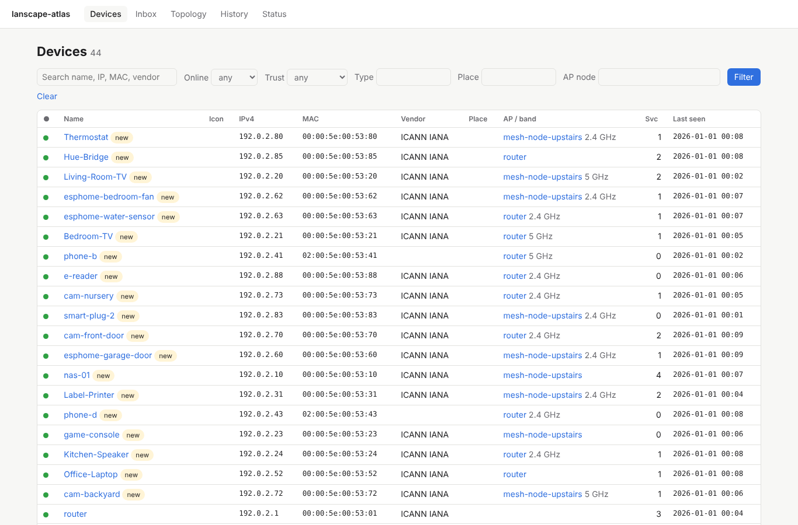
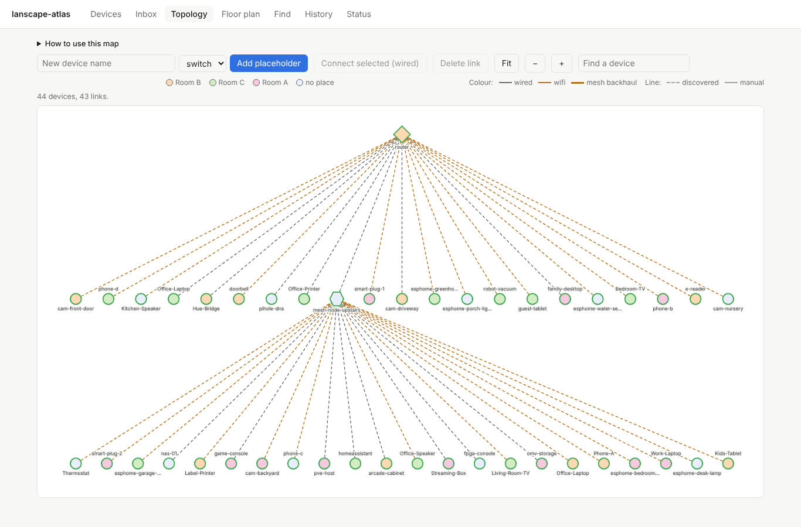

# lanscape-atlas

A self-hosted home network inventory and mapping tool. It discovers the devices on
your LAN, ties MAC, IPv4 and hostname together, records which services each device
runs, and lets you (or Claude, over MCP) give every device a durable identity: a
name, type, icon and place that survives DHCP churn and routers that forget
hostnames.




The screenshots show a generated "fake house" dataset in documentation address
ranges, not a real network.

## Features

- **Discovery** with five collectors: ASUS router client list (`asusrouter`),
  `arp-scan`, mDNS, SSDP, and a nightly light `nmap` scan. A deep `nmap -sV` scan
  runs on demand for a single device. Devices with `scan_policy=never` are skipped.
- **Stable identity**: names, types, icons, places, owners, notes and trust level,
  each with provenance ("set by user / claude / collector") and precedence
  user > claude > collector.
- **Inbox** for never-seen devices and unclaimed random-MAC interfaces, with quick
  actions to name, type, claim, or mark known/unwanted.
- **Topology** view: router, mesh nodes, switches, devices. Discovered links are
  dashed, manual links solid; drag to arrange, add placeholders for unmanaged switches.
  See [Topology](#topology) below.
- **History** of every change, grouped by batch, with per-batch **Undo**.
- **Status** page with collector health and counts.
- **HTTP API** under `/api/v1` (OpenAPI via FastAPI) and an **MCP server** at `/mcp`
  in the same process.
- **Vendor lookup** from a local IEEE OUI file; no network call at lookup time.
- **Floor plan** (Phase 2): upload a plan or start a blank one with real dimensions,
  set its scale, draw rooms, place devices. See below.
- **Bluetooth Find** (Phase 3): where was my remote or phone last heard, by room, from
  ESP32 Bluetooth proxies through Home Assistant. See below.

## Topology

The Topology page draws the network as a graph. A "How to use this map" box at the top
explains the controls (open the first time, then it remembers whether you closed it).

- **Navigate:** scroll or pinch to zoom, drag empty space to pan, `+` / `-` buttons
  (or the `+`, `=` and `-` keys while the graph has focus) zoom by 25% about the centre of
  the view. Fit shows everything.
- **Search:** the "Find a device" box matches name, hostname, vendor, IP and MAC. Use the
  arrow keys and Enter (or click) to pick a result: the device is selected, centred at a
  zoom of at least 1.5, and pulses once. An exact IP or full MAC ranks first, then names
  that start with what you typed.
- **Colours:** a device's fill is its room's colour (ten colours, repeated beyond ten
  rooms; the toolbar legend lists the rooms that have devices). The border still shows
  online / offline and selection.
- **Connections:** discovered links come from the router's client list and are dashed;
  links you draw are solid. Shift-click two devices (or drag a box round them) and use
  "Connect selected". For an unmanaged switch or hub, "Add placeholder", connect it to its
  uplink, then connect each device behind it: once a device is wired by hand to a switch
  or hub, its dashed router line is hidden (routers, mesh nodes and access points keep
  theirs). Deleting the manual link brings the dashed line back.

## Floor plan

The **Floor plan** page (`/floorplan`) puts devices on a map of your home.

- **Start a plan.** With no plan yet, the page offers two choices:
  - *Upload an image*: a PNG, JPG or SVG up to 10 MiB. Replacing the image later
    requires the same aspect ratio, so room outlines and device points stay valid.
  - *Start a blank plan*: type the floor's width and depth in feet or metres (each 1 m
    to 300 m). The plan is drawn as a grid of 1 ft squares with a heavier line every
    10 ft (or 0.5 m squares, heavier every 5 m); zoomed out so far that a square is
    under 6 px on screen, only the heavier lines show. The page opens in *Draw room*
    mode, ready for the first room.
- **Add an image to a blank plan** with *Add an image*. The blank plan's real width
  carries over as the image's scale. With no rooms or walls drawn, an image of any
  aspect ratio is accepted (the plan's depth then follows the image). **Once rooms or
  walls exist, an image whose aspect ratio differs from the plan is refused: crop it
  to the plan's proportions first.** There is no way back from image to blank, other than undo.
- **Set scale** (image plans). Press *Set scale*, click the two ends of something whose
  length you know (a wall, a door), type that length and press *Save scale* or Enter.
  Lengths can be written `14'6"`, `14' 6"`, `14 ft`, `174 in`, `4.4 m` or `440 cm`; a
  bare number, zero, a negative length, `5'13"` or text is refused with a message and
  nothing is saved. Setting the scale again replaces it; rooms and devices keep their
  positions. Once a scale is set, the line you draw also shows its current length.
- **Units.** When the plan has a scale (a blank plan always does), the toolbar shows
  the plan's real size and an *ft* / *m* toggle. Imperial lengths show to the nearest
  inch (`14' 6"`), metric to the nearest centimetre (`4.42 m`). Units are for display
  only; sizes are stored in millimetres.
- **Draw rooms.** Press *Draw room*, click the corners, close the shape (click the
  first corner or *Close room*), name it ("Room A") and save. Saving an existing name
  redraws that room. Rename rooms from the Rooms list. A device point must lie
  inside its room; a point on an edge counts as inside.
- **Place devices.** Drag a device from the list onto a room, drag a placed device to
  move it within its room, or select it and use the arrow keys. Nothing is written
  until you press *Save changes*; *Discard* drops the pending edits. If another tab
  or Claude moved the same device in the meantime, the save is refused (409) and the
  page reloads with a message instead of overwriting.
- **Roaming devices** (phones, laptops) belong to a room's list but have no point on
  the plan. Tick *roaming* next to the device in the list, or press *Mark roaming* (and *Mark fixed* to undo it) on its device page.
  Turning roaming off leaves the device in that room's list, ready to be dropped.
- **Draw walls and doors.** Press *Draw* and pick a tool. Drawing is a picture only:
  rooms stay the outlines made with *Draw room*, and placement and Bluetooth use those.
  - *Wall*: click the start, then the end. *Polyline*: each click adds a corner;
    double-click or Enter ends it, a click on the first corner closes it, Escape cancels.
    A second click on the same spot (a double-click) never makes a zero-length wall.
  - *Typed length* (plans with a scale): after the first point, type a length (`10'`,
    `3.5 m`, the same formats as *Set scale*) and press Enter; the next point goes
    exactly that far toward the pointer. A length that would run off the plan is refused.
  - *Shift* locks a wall to 0°, 45° or 90°, measured on the real plan, so 45° looks
    square on a plan that is not.
  - *Snap* (toolbar, on by default; hold Alt to stop it for a moment): a point within
    8 px of a wall corner or a room corner takes it exactly, otherwise it goes to the
    1 ft (or 0.5 m) grid on a blank plan or an image plan with a scale. *Draw room*
    corners snap to wall corners too, so rooms line up with the walls.
  - *Door*: point at a wall to see the door (80 cm or 32 in wide, 4% of the plan's
    width on an image without a scale), click to place it. It sits on the wall's line
    at the wall's angle and is drawn as a gap in the wall with its swing.
  - *Select*: click a wall or door, drag it to move it, drag a wall corner to reshape
    it or a door's end to change its width; *Flip door* cycles which side it swings to
    and which end the hinge is on; Delete (or *Delete*) removes it; the arrow keys
    nudge it.
  - With a scale, each wall segment shows its length (*Show lengths* in the toolbar)
    and a wall being drawn shows its length as you go.
  - Nothing is written until *Save changes*; *Discard* drops the pending drawing, and
    leaving the page asks first. While a drawing edit is pending the page stays in
    Draw mode, and while a placement is pending *Draw* is disabled, so one save never
    mixes the two. If another tab (or an undo) changed the drawing since the page
    loaded, the save is refused (409), nothing is written and the page reloads with a
    message. Shapes never take clicks outside Draw mode. Up to 5,000 shapes per plan.
  - Drawing is page-only: there is no API or MCP write for it, and `get_floor_plan`
    leaves the shapes out. `GET /api/v1/floorplan` lists them (`shapes`).
- **Undo.** Every plan, room, placement and drawing change (including creating a blank
  plan, adding an image, the scale and the units) is a batch in History and can be
  undone like any other change. Undoing the plan's creation is refused while rooms or
  walls and doors drawn after it still exist: undo or delete those first.
- **Zoom and pan** work in every mode. Zoom from 1x (*Fit*, the whole plan) to 8x with
  the mouse wheel or a trackpad pinch (about the pointer), a two-finger pinch on a touch
  screen, the *+* / *−* buttons, or the `+`, `-` and `0` (fit) keys while the plan has
  focus. Pan by dragging empty plan space, or hold Space and drag anywhere on the plan;
  a press that moves less than 4 px is still a click, so *Draw room* corners work as
  before. Device markers and labels keep their size on screen. The view is not saved.
- **Search.** Type a device name, IP or MAC, or a room name, in the search box and pick
  a result (arrow keys and Enter work too). A placed device is zoomed to, centred,
  selected and pulsed; a roaming device, or one waiting in a room's list, shows its room
  and its list entry; an unassigned device shows its list entry; a room is zoomed to fit
  and highlighted. Devices are ranked as on Topology (`GET /floorplan/search?q=`).

HTTP: `GET /api/v1/floorplan` returns the plan, rooms and device placements,
`PUT /api/v1/floorplan/rooms` saves a room, and `POST /api/v1/floorplan/placements`
saves placements (with `based_on` batch ids for stale-write detection).

MCP: `get_floor_plan` and `place_devices` are **text only**. They return room names,
polygons and device positions; image bytes and file paths are never served, so the
plan image reaches a browser only through the web UI. Writes use actor `claude`. The
plan carries `blank`, `width_mm` (its real width, or null for an image without a
scale) and `units`; a blank plan's `width` and `height` are millimetres, an image's
are pixels. Creating a blank plan, the scale and the units are set on the page only.

The image is stored in `$DATA_DIR/floorplan` (mode 0750, created by
`deploy/setup-alpine.sh`; create it yourself on a manual install) and is never in
git. A floor plan is personal data: keep room names and images out of the repository.
Put real room names in a denylist file and point `LANSCAPE_LEAK_DENYLIST` (or
`LANSCAPE_DENYLIST`) at it; `scripts/check_leaks.py` also rejects tracked image files.

**Upgrading from Phase 1.** The database migrates from schema v1 to v2 on start. The
scripted install backs up `atlas.db` first. On a manual install, copy `atlas.db`
before upgrading. The floor plan images live in `$DATA_DIR/floorplan`; back that
directory up together with `atlas.db` (the scripted backup copies only `atlas.db`).
Schema v5 (blank plans and scale) rebuilds the `floor_plan` table on start; an existing
plan keeps its image, has no scale and shows imperial units until you change them. Schema v6 adds the
`plan_shape` table for drawn walls and doors; nothing existing changes.

## Bluetooth (Find)

The **Find** page (`/find`) answers "where did I last hear this?" for Bluetooth devices
you have claimed: the room, how long ago, how strong, and a findability badge. The same
answer is on the device page, on the floor plan (the room a selected device was last heard
in is highlighted, and the device appears as a "heard" entry in that room's list) and over
MCP (`where_is`). Bluetooth never moves a device on the plan; it only reports where it was
heard.

Sightings come from Home Assistant's Bluetooth integration, which already merges the
adverts of every ESP32 Bluetooth proxy and local adapter. lanscape-atlas subscribes to
that stream over HA's WebSocket API; it does not talk to the proxies itself.

Home Assistant only pushes an advert when its content changes (a steady beacon is pushed
about once), but it replays its latest advert per device whenever a subscription starts.
So lanscape-atlas re-subscribes every `snapshot_s` seconds (default 30) and reads that
replay as a snapshot. Each advert is placed at the time Home Assistant heard it, corrected
for any clock difference between the two hosts, and a replayed advert is never counted
twice. "Last heard" is therefore accurate to about one snapshot interval.

### Prerequisites

- Home Assistant with the **Bluetooth** integration and at least one proxy (ESPHome
  Bluetooth proxy, or a local adapter).
- A **long-lived access token** from an **administrator** account (profile page, *Security*,
  *Long-lived access tokens*). Home Assistant only allows the `bluetooth/subscribe_advertisements`
  command for administrators, so a token from a non-admin user is refused. The token is a
  secret: it can control your whole Home Assistant. Keep it out of the repository and out of
  logs; lanscape-atlas redacts it from its own output.

### Connecting to Home Assistant

`config.example.toml` ships the `[home_assistant]` table commented out, because a URL
without a token is a configuration error. How you turn it on depends on how you installed.

**Scripted install (`deploy/setup-alpine.sh`).** The script re-renders `config.toml` from
`setup.env` on every run, and stops if `config.toml` was edited by hand (see *Scripted
install and upgrade*). Add the Home
Assistant keys to `/etc/lanscape-atlas/setup.env` (mode 0600) with `vim` and re-run the
script:

```sh
HA_URL=http://192.0.2.10:8123
HA_TOKEN=paste-the-token-here
# HA_VERIFY_TLS=true
```

The script writes an active `[home_assistant]` table (URL, token, `verify_tls`) into
`config.toml` (mode 0600, readable only by the service user), checks that it parses back
to the same values, and never prints the token, not even with `--dry-run`. Leave `HA_URL`
empty to turn Bluetooth off again.

To change the weak-signal cut-off of the candidate list (see *Claiming a device*), add
`BLE_CANDIDATE_MIN_RSSI` (a whole number of dBm from -127 to 0) to `setup.env`; the script
validates it and writes it as `candidate_min_rssi` in the `[bluetooth]` table. Unset keeps
the default, -80.

**Manual install.** Edit `config.toml` with `vim`, uncomment the table and fill it in,
then restart the service:

```toml
[home_assistant]
url = "http://192.0.2.10:8123"
token = "paste-the-token-here"
verify_tls = true

[bluetooth]
retention_days = 14   # nightly prune of per-minute sightings
flush_s = 60          # how often closed minutes are written to the database
snapshot_s = 30       # how often Home Assistant's latest adverts are re-read (see above)
candidate_min_rssi = -80  # weaker candidates are hidden behind "Show N weak" (dBm, -127..0)
```

Keep `snapshot_s` at 30 or below: the *steady* badge needs a sighting in 48 of the last 60
minutes, and at 60 the snapshots drift against the minute boundaries, so a device that
advertises every 20–30 s can miss whole minutes and look intermittent.

The `LANSCAPE_HA_TOKEN` environment variable overrides `token`, but only in the
environment the service actually runs in: exporting it in your shell does not reach the
OpenRC service. Use it only where you control the service environment (for example when
running `lanscape-atlas serve` by hand); otherwise put the token in `config.toml` or
`setup.env`.

Without a `[home_assistant]` table the Find page still shows claimed devices from the
database but says it needs Home Assistant.

### Android phones

A phone is only findable while something advertises. Install the Home Assistant Companion
app and, under *Settings*, *Companion app*, *Manage sensors*, turn on **BLE Transmitter**.
Pick an advertise mode (*Balanced* is a reasonable start; *Low latency* is faster but uses
more battery) and leave *Transmit power* at its default. Then exempt the app from battery
optimisation (Android *Settings*, *Apps*, Home Assistant, *Battery*, *Unrestricted*);
otherwise Android throttles the app and "last heard" lags by many minutes. The sensor
exposes the iBeacon ID (UUID, major, minor); the candidate list shows the same identity as
`<uuid>/<major>/<minor>`.

### Claiming a device

Open `/find`. Under **Candidates** are stable devices heard recently that are not yet
claimed: iBeacons, and addresses that look stable (a known vendor, a static-random
address, or one heard steadily for 30 minutes). Press a remote's button, or hold a tag
next to a proxy, and its signal strength stands out. Candidates are listed strongest
signal first; those weaker than `candidate_min_rssi` (default -80 dBm), usually a
neighbour's, are hidden behind a **Show N weak** link (the API and MCP take
`include_weak`; their candidate list carries `min_rssi` and `weak_hidden`, the number of
weak candidates left out). Each candidate shows the scanner that heard it by name (and room, once
the scanner is linked). Select the candidate, then
under **Claim the selected candidate** either attach it to an existing device or create a
new one (name and type), and press **Claim**. Claims are in History and can
be undone; the device page has an **Unclaim** button.

A neighbour's device that keeps showing up can be hidden with its row's **Not mine**
button. It disappears from the candidate list (and is not counted in **Show N weak**), and
atlas records nothing about it, as for any unclaimed device. Only a salted digest of its
identity and a label (its advert name, else the vendor of its address, else "Unnamed
device") are stored for the hide (a device you once claimed keeps its address in that
claim's History entry). Hidden devices are listed on the **Status** page under **Hidden
Bluetooth devices**, each with an **Unhide** button; a hide is also in History and can be
undone. API: `POST /api/v1/ble/hide` with `{"identity": ...}` (a current candidate),
`GET /api/v1/ble/hidden` and `DELETE /api/v1/ble/hidden/{id}`. MCP: `hide_ble`. Claiming a
hidden device through the API or MCP unhides it, in the same undoable batch.

### Linking scanners

Room-level location comes from where each proxy is. On the **Status** page, under
**Bluetooth scanners**, link each proxy to the atlas device it runs on, then give that
device a room on the floor plan. The page suggests devices whose name matches the proxy
or whose Wi-Fi MAC plus 2 equals the proxy's Bluetooth address (an ESP32's Bluetooth MAC
is usually its Wi-Fi MAC plus 2). An unlinked scanner still records sightings, but
without a room.

### What is findable

| Kind | How it is matched | What "last heard" means |
|---|---|---|
| Android phone | HA Companion app "BLE Transmitter" iBeacon (UUID, major, minor) | Current, to about one snapshot interval (default 30 s). Lags if Android battery optimisation throttles the app. |
| Beaconing remote (advertises every few seconds) | Static or public address | Current, to about one snapshot interval. |
| Press-to-advertise remote | Static or public address | When it was last pressed. |
| Headphones with a stable address | Static or public address | Last time they were idle and nearby. Many go silent while connected. |
| Anything with a rotating address | Not matched | Not findable. Never shown. |

The Find page badge (steady, intermittent, not heard in 24 hours) comes from observed
behaviour, so you can see which devices are reliable.

### ESPHome example

`deploy/esphome/ble-proxy.example.yaml` is a generic classic-ESP32 proxy: passive scanning
with a moderate duty cycle (a Wi-Fi ESP32 shares one radio), and only `!secret` references
for credentials. It is a reference. Adopt your proxies in Home Assistant's ESPHome
integration and keep the real per-proxy YAML and `secrets.yaml` there, not in this
repository.

### Limitations

- Each sighting is attributed to the one scanner that owns the advert in Home Assistant, so
  the "room" is that scanner's room. A device between two rooms flips when ownership
  changes; switching is coarse, not trilateration.
- Home Assistant must be reachable. While the link is down the Find page shows a banner and
  no new sightings are recorded. On reconnect, Home Assistant's replay restores only each
  device's latest advert (filed at the time it was heard), not everything in between.
- The advert count of a sighting counts snapshots and content changes that saw the device
  in that minute, not every advert on the air.
- Devices that rotate their address (iPhones, AirPods and most modern phones and earbuds)
  cannot be matched and are not findable.

## Requirements

- Python 3.12 or newer, `arp-scan` and `nmap`.
- The host or container must be **bridged onto the LAN segment it scans**. ARP and
  mDNS only work with layer-2 adjacency; a NATed or routed container will see
  almost nothing.
- IPv4 only.

## Install on an Alpine LXC

Run as root inside a container that is bridged to your LAN. Alpine's `python3`
package normally includes the `venv` module; if `python3 -m venv` reports it
missing on your release, install `py3-virtualenv` and use `virtualenv` instead.

```sh
apk add python3 py3-pip git arp-scan nmap

# Get the code; every later step runs from inside the checkout
git clone https://github.com/SDNick484/lanscape-atlas.git
cd lanscape-atlas

# Application and virtualenv
python3 -m venv /opt/lanscape-atlas/venv
/opt/lanscape-atlas/venv/bin/pip install .

# Service user, group and data directory
addgroup -S lanscape
adduser -S -D -H -G lanscape -h /var/lib/lanscape-atlas lanscape
install -d -m 0700 -o lanscape -g lanscape /var/lib/lanscape-atlas
install -d -m 0750 -o lanscape -g lanscape /var/lib/lanscape-atlas/floorplan

# Configuration
cp config.example.toml /var/lib/lanscape-atlas/config.toml
chown lanscape:lanscape /var/lib/lanscape-atlas/config.toml
chmod 600 /var/lib/lanscape-atlas/config.toml
$EDITOR /var/lib/lanscape-atlas/config.toml

# Create the database and fetch the vendor list
su -s /bin/sh lanscape -c '/opt/lanscape-atlas/venv/bin/lanscape-atlas migrate'
su -s /bin/sh lanscape -c '/opt/lanscape-atlas/venv/bin/lanscape-atlas update-oui'

# Service
install -m 0755 deploy/openrc/lanscape-atlas /etc/init.d/lanscape-atlas
rc-update add lanscape-atlas default
rc-service lanscape-atlas start
```

**Make it reachable from the LAN.** By default `serve` listens on `127.0.0.1`
only, so other machines cannot open the UI. Set `bind_host` in
`/var/lib/lanscape-atlas/config.toml` to the container's LAN address (for example
`bind_host = "192.0.2.50"`) or to `"0.0.0.0"`, then restart:

```sh
rc-service lanscape-atlas restart
```

The UI is then at `http://<bind_host>:8720`. Without an `api_token`, the app only
answers to `localhost`, `bind_host` and the names in `allowed_hosts` (see below):
with `0.0.0.0`, or if you browse by a DNS name, add the address or name you type in
the browser to `allowed_hosts` **with a port pattern**, e.g.
`allowed_hosts = ["192.0.2.50:*", "atlas.example.com"]` (a bare entry matches only a
Host header without a port, which is what a reverse proxy on 80/443 sends).

Token mode (`api_token` set) turns the Host check off and assumes an authenticating
proxy (e.g. Cloudflare Access) protects the pages and `/topology`; don't expose
token mode without one.

`arp-scan` and `nmap` need raw sockets. The init script grants
`cap_net_raw` and `cap_net_admin` to the unprivileged `lanscape` user through
`capabilities="^cap_net_raw,^cap_net_admin"` and exports `NMAP_PRIVILEGED=1` so
nmap uses them. Ambient capabilities under `supervise-daemon` require
**OpenRC 0.45 or newer**; on older versions run the service as root, or set file
capabilities on the binaries and remove the `NMAP_PRIVILEGED` line.

The service logs (INFO level, with time, level and logger name) to
`/var/log/lanscape-atlas.log`.

`lanscape-atlas update-oui` re-downloads the IEEE MA-L list. It validates the file
before replacing the old one and leaves the old file in place on any failure, so it
is safe to run from cron. To refresh it weekly as the `lanscape` user, add this line
to `/etc/crontabs/root` and make sure `crond` runs (`rc-update add crond default`,
`rc-service crond start`):

```sh
17 4 * * 0 su -s /bin/sh lanscape -c '/opt/lanscape-atlas/venv/bin/lanscape-atlas update-oui'
```

### Scripted install and upgrade

`deploy/setup-alpine.sh` performs the steps above and is safe to re-run, so the same
command installs and later upgrades. It needs root, an Alpine container with OpenRC
0.45 or newer, and Python 3.12 or newer. It only touches `/opt/lanscape-atlas`,
`/etc/lanscape-atlas`, `/var/lib/lanscape-atlas`, the log file, its own init script
and logrotate entry; it never upgrades packages or restarts other services.

1. Copy `deploy/setup.env.example` to `/etc/lanscape-atlas/setup.env`, fill it in and
   `chmod 600` it. It holds your router password, API token and (for Bluetooth Find)
   your Home Assistant token, so keep it out of the repository.
2. Copy the script to the container (for a private repository there is nothing to
   clone from yet) and look before you leap:

   ```sh
   sh setup-alpine.sh --dry-run
   ```

3. Run it without `--dry-run`. For a private repository it first generates a
   read-only deploy key, prints the public half and exits (status 3); add it under
   the repository's Settings, Deploy keys, then run it again.

Each run stops the service, checks out `--ref` (default `main`), reinstalls into the
virtualenv, backs up the database (last three kept) when the code changed, renders
`config.toml` from `setup.env`, migrates, restarts, and finishes with a smoke test of
`/api/v1/collectors` and `/api/v1/devices`. The API token is generated on the first run
and kept afterwards unless you set `API_TOKEN`; the script never prints it.

Edit `setup.env`, not `config.toml`: the latter is regenerated from `setup.env` on every
run. Its second line, `# sha256: ...`, lets the script recognise a hand edit. If a hand
edit to `config.toml` would be lost or changed by the new render, the script stops
before replacing it, leaves it unchanged, and lists those settings by name (never their
values), each with the `setup.env` key that controls it. Move them into `setup.env` and
re-run, or re-run with `--discard-config-edits` to overwrite them. If every setting in
the edited file already equals what `setup.env` renders (for example, you copied a
hand-added table into `setup.env`, or only added a comment), the file is simply
replaced, with a backup.

A `config.toml` written by an older script (no `# sha256:` line) counts as hand-edited
if it has a setting the new render would drop, or a different value for a key that
`setup.env` leaves unset or empty. An unset key falls back to the script's default
(for example `BIND_PORT=8720`), and that default does not override your file; set the key
in `setup.env` to change the value. `--dry-run` reports a hand edit too.

A file with the `# sha256:` line is checked right after preflight, before the service is
stopped. Every file is checked again right after the new code is checked out, against
its `config.example.toml`, before anything is installed. If the run stops after the
service was stopped, the script starts the old, untouched install again with your
unchanged `config.toml` (or, if that fails, tells you to run
`rc-service lanscape-atlas start`).

Before each replace, the current file is copied to
`/var/lib/lanscape-atlas/config.toml.YYYYmmdd-HHMMSS` (UTC, mode 0600); the newest five
are kept. A `config.toml.prev` left by older versions of the script is not touched;
delete it yourself once you no longer need it.

### Commands

| Command | Purpose |
|---|---|
| `lanscape-atlas migrate` | Create the data directory (mode 0700) and database; prints the DB path |
| `lanscape-atlas serve [--host H] [--port P]` | Run the web app, API and MCP server |
| `lanscape-atlas update-oui` | Download and validate the IEEE OUI vendor list |
| `lanscape-atlas ingest-file FILE.json` | Ingest serialized observations (useful for demos and tests) |

`serve` honors proxy headers from the addresses in `LANSCAPE_FORWARDED_ALLOW_IPS`
(comma-separated, default `127.0.0.1`). Set it to your reverse proxy's address if
the proxy is not on the same host.

## Configuration

Settings live in `$LANSCAPE_DATA_DIR/config.toml` (default data directory
`/var/lib/lanscape-atlas`). `config.example.toml` is a complete, commented starting
point.

| Key | Default | Meaning |
|---|---|---|
| `data_dir` | `/var/lib/lanscape-atlas` | Holds `atlas.db`, `config.toml`, `oui.csv` |
| `bind_host` | `127.0.0.1` | Address `serve` listens on |
| `bind_port` | `8720` | Port `serve` listens on |
| `scan_interface` | `eth0` | Interface `arp-scan` uses |
| `observation_retention_days` | `30` | How long raw observations are kept |
| `ip_match_window_min` | `10` | Window for correlating an IP-only sighting to a known device |
| `api_token` | unset | Static bearer token required for `/api` and `/mcp` |
| `allowed_hosts` | `[]` | Extra `Host` headers the app accepts when no `api_token` is set |

`[router]` configures the ASUS collector; remove the table or leave `host` empty to
disable it.

| Key | Default | Meaning |
|---|---|---|
| `host` | none | Router address, e.g. `192.0.2.1` |
| `username` | `admin` | Router login |
| `password` | empty | Router password |
| `use_ssl` | `true` | Use HTTPS to the router |

Each collector has its own table, `[collectors.<name>]`, with `enabled`,
`timeout_s`, and either `interval_s` or (for `nmap_light`) a `cron` expression.

| Collector | Default schedule |
|---|---|
| `asusrouter` | every 120 s (enabled when `[router]` is set) |
| `arp` | every 300 s |
| `mdns` | flushed every 60 s |
| `ssdp` | every 600 s |
| `nmap_light` | cron `17 3 * * *` (nightly) |

Secrets can come from the environment instead of the file:
`LANSCAPE_ROUTER_PASSWORD`, `LANSCAPE_API_TOKEN`. `LANSCAPE_DATA_DIR` moves the data
directory.

### `allowed_hosts`

When no `api_token` is set, the whole app (pages, `/api`, `/topology`, `/mcp`) only
accepts requests whose `Host` header is `localhost`, `127.0.0.1`, the configured
`bind_host` (each with or without a port), or an entry in `allowed_hosts`; anything
else gets `421`. This blocks DNS-rebinding attacks. If you bind to `0.0.0.0` and
browse to the container by its LAN address or name, list that address or name here.
Matching is exact:

- A bare entry such as `"atlas.example.com"` matches only a `Host` header **without**
  a port.
- `"atlas.example.com:*"` matches that name on **any** port.
- `["*"]` disables the check; avoid it unless something else protects the app.

In every mode, a `POST`, `PUT`, `PATCH` or `DELETE` to `/api/*` or `/topology/*` that
carries an `Origin` header for a different host than the request's `Host` is refused
with `403`, so other web pages cannot trigger undo or scans from your browser. A
reverse proxy must therefore pass the original `Host` header through. Clients that
send no `Origin` (curl, MCP clients) are unaffected.

## Remote access and security

lanscape-atlas has no accounts of its own. Choose one of these setups:

1. **Behind an authenticating proxy (recommended for remote access).** Publish the
   app through Cloudflare Access or another auth proxy for the web pages, for
   example at `https://atlas.example.com`. Set `api_token` so `/api` and `/mcp`
   additionally require `Authorization: Bearer <token>`; automation and MCP clients
   usually cannot complete an interactive proxy login. Add the public hostname to
   `allowed_hosts` if you run without a token.
2. **LAN-only, no auth.** Bind to a LAN interface and set nothing else. This works,
   but **anyone who can reach the port can read and write your inventory**, including
   renaming devices, changing trust, deleting links and triggering scans. Use it only
   on a network you fully trust, and never expose the port to the internet.

## MCP

The MCP server uses streamable HTTP at `/mcp`. With a token configured:

```sh
claude mcp add --transport http atlas https://atlas.example.com/mcp \
  --header "Authorization: Bearer YOUR_API_TOKEN"
```

Tools: `find_device`, `list_devices`, `get_device`, `list_services`, `update_device`,
`claim_interface`, `set_place`, `run_deep_scan`, `recent_changes`, `undo`,
`get_floor_plan`, `place_devices`, `where_is`, `ble_candidates`, `claim_ble`, `hide_ble`.

Everything Claude writes is recorded with actor `claude`. It appears in History as
its own batch and can be undone like any other change. Tool output never includes
router credentials or raw configuration.

The server does not yet use the `mcp-server-shared` helpers and could adopt them
through that repository's sync tooling.

## Development

```sh
python3 -m venv .venv
.venv/bin/pip install -e '.[dev]'
.venv/bin/pytest
.venv/bin/ruff check . && .venv/bin/ruff format --check .
.venv/bin/mypy src
.venv/bin/python scripts/check_leaks.py
.venv/bin/pre-commit install      # runs the leak check on every commit
```

CI runs ruff, mypy, pytest and the leak check. Tests never touch the network.
`lanscape-atlas ingest-file tests/fixtures/fake_house.json` loads the fake-house
dataset for local UI work.

## Privacy rules for contributors

This repository is public; real network data must never enter it. Fixtures, docs and
examples use only:

- IPv4 `192.0.2.0/24`, `198.51.100.0/24`, `203.0.113.0/24`
- MACs `00:00:5e:00:53:00` to `00:00:5e:00:53:ff` (and `02:00:5e:00:53:xx` for
  synthetic random MACs)
- generic hostnames and rooms, and `atlas.example.com` for the app itself

Tools:

- `scripts/check_leaks.py` fails on MAC addresses outside the documentation range,
  128-bit UUIDs other than `00000000-0000-4000-8000-0000000000xx` and the Bluetooth base
  (`xxxxxxxx-0000-1000-8000-00805f9b34fb`), private (RFC 1918) IPv4 addresses, and any
  term from your personal denylist. The
  pre-commit hook runs it on staged files; CI runs it on the whole repository.
- The optional denylist lives **outside the repository** at
  `~/.config/lanscape-atlas/denylist.txt` (one term per line, `#` comments). Put your
  hostnames, room names and domain there. Set `LANSCAPE_DENYLIST` to use another
  file; if set, the file must exist and be readable or the check fails.
  `LANSCAPE_LEAK_DENYLIST` names an additional denylist file (for example room
  names) with the same rules; terms from all sources are merged.
- The same script rejects any `.png`, `.jpg`, `.jpeg`, `.svg`, `.gif` or `.webp`
  file outside `docs/screenshots/`: floor plans and photos stay in the data dir.
- `scripts/anonymize.py` rewrites a real capture into documentation values with a
  stable mapping, so relationships between devices survive:

  ```sh
  python scripts/anonymize.py --seed SOME_SEED --names real-hostnames.txt capture.json > fixture.json
  python scripts/check_leaks.py fixture.json
  ```

  `--names` takes a file of real hostnames, one per line; they become `host-1`,
  `host-2`, and so on. Hostnames are not detected automatically, so list them.
  Keep the real capture and names file out of the repository.

  For a Home Assistant Bluetooth advert capture (one JSON list of the advert objects
  `bluetooth/subscribe_advertisements` delivers; JSON lines are not accepted) add `--ble`:

  ```sh
  python scripts/anonymize.py --seed SOME_SEED --ble capture.json > ha_adverts.json
  ```

  Every address and scanner source becomes `00:00:5e:00:53:xx` and every iBeacon UUID
  `00000000-0000-4000-8000-0000000000xx`, consistently within the capture. That includes the
  iBeacon frame and the local name inside HA's `raw` hex (a `raw` that does not parse is
  blanked), MACs inside any string, custom service UUIDs (dashed, or as a bare 32-hex-digit
  string) and `service_data` keys. Advert local names often contain personal names ("Alex's
  phone"), so pass `--names` with them too. Other manufacturer payloads and `service_data`
  values are copied as they are; review them by hand.

Neither tool detects bare 12-hex-digit MACs without separators (for example
`aabbccddeeff`). Review such values by hand before committing.

## Known limitations

- IPv4 only.
- Links behind unmanaged switches cannot be discovered; draw them manually in the
  Topology view.
- Phones and other devices with randomized MACs appear as new interfaces until you
  claim them onto a device in the Inbox.
- The ASUS router collector has only been tested against a simulated router.

## Roadmap

| Phase | Scope |
|---|---|
| 2 (done) | Floor plan: upload an image or SVG, draw rooms, drag devices onto them |
| 3 (done) | Bluetooth "Find" via Home Assistant and ESP32/ESPHome Bluetooth proxies, with rough room location |
| 4 | MQTT / Home Assistant publishing and new-device notifications |
| 5 | Z-Wave devices via Hubitat or Home Assistant |

## License

MIT. See [LICENSE](LICENSE).
